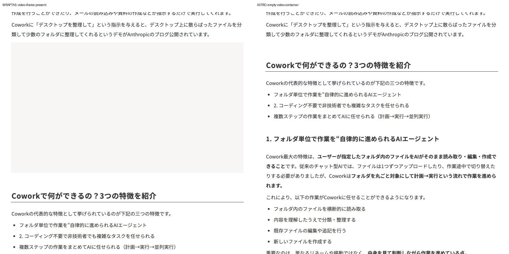
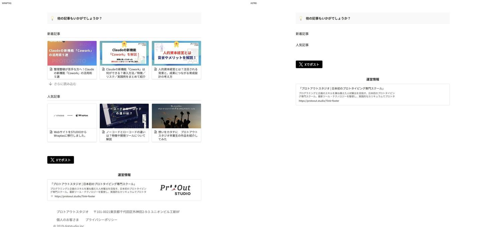
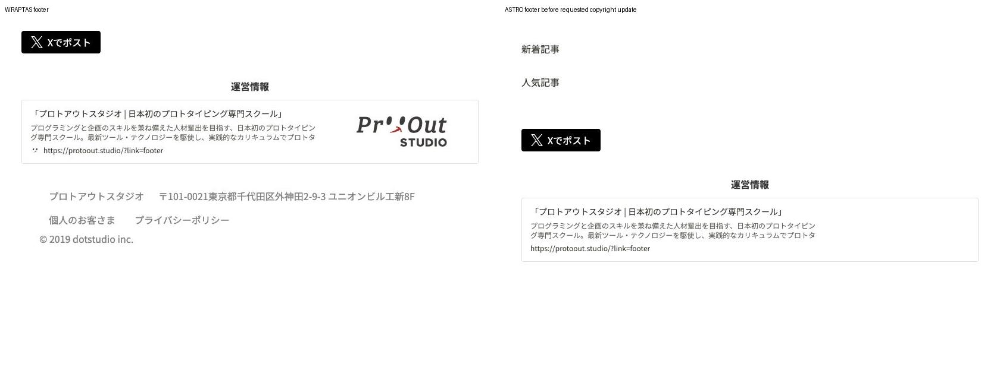
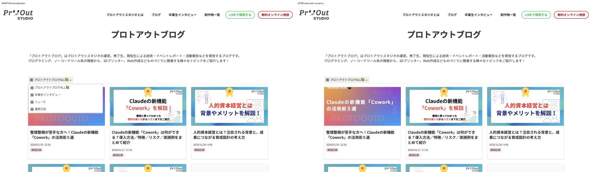

# Wraptas／Astroプレビュー比較調査

調査日：2026-11-14（JST）。現行 https://protoout.studio/ と移行先 https://protoout.github.io/web/ を比較。基準コミット `87e099d4b0756df36cdfe082c00e08b013f6f0c0`。

## 結論と現在の状態

代表ページの先頭レイアウトやカード配置は概ね再現されています。一方、代表9ページ以外の静的HTMLには、本文動画・記事回遊カード・共通フッターが空のままの例があります。既にAstroで生成されているため、Astroへ変更すれば自然に解消するものではありません。生成データと共通部品の対応が必要です。

ユーザー指示に従い、調査で発見した差は未修正のままIssue化しました。唯一別途指定されたコピーライトは、公開対象262ページで `© 2019-2026 プロトアウトスタジオ / dotstudio inc.` に変更しました。404ページは元からフッターがありません。コピーライトがなかった253ページにはそのテキストだけ追加し、旧住所や旧リンクは復元していません。

## 調査範囲と方法

Codex内蔵ブラウザで両サイトを同じ幅で順次確認。PC1440pxで11ページずつ、スマホ390pxで10ページずつ、計42枚のフルページ画像と対応するDOM計測JSONを保存。768・1024・1280pxではヘッダーを補助確認しました（全ページのタブレット調査ではありません）。アクセスは逐次実施し、ログイン・非公開ページの確認はしていません。

先頭から末尾までスクロールして遅延表示を促し、表示要素の寸法、画像、見出し、カード、iframeを読み取り。PC・スマホの一覧比較、欠落箇所の拡大比較画像を目視確認しました。高さはDOM実測であり、同じ高さでも内容一致を保証しません。Xなど外部埋め込みの高さは変動するため、高さ差だけを不具合とはしていません。

### 比較した画面と流れ

- トップ→ブログ／卒業生インタビュー／制作物一覧：主要構成とカード配置を比較。
- 個人向けschool／法人向けbiz：ヒーロー、本文セクション、CTAを比較。
- ブログ記事3件、インタビュー詳細1件、制作物詳細1件：本文・末尾の回遊カードとフッターを比較。古い記事1件のみPCで確認。
- モバイルメニュー：両サイトで開閉を確認。
- ブログ「さらに読み込む」：両サイトで表示10件→69件を確認。
- ブログビュー切替：現行はメニューが開きニュース11件へ切替可能。移行先は開かず。比較本体は現行をALLへ戻して撮影。

| 画面 | 幅 | 現行URL／ページ高 | 移行先URL／ページ高 |
|---|---:|---|---|
| article-control | 1440 | [7265px](https://protoout.studio/2ed6077e488780dca32eda95afc5cc77) | [7265px](https://protoout.github.io/web/2ed6077e488780dca32eda95afc5cc77/) |
| article-control | 390 | [8201px](https://protoout.studio/2ed6077e488780dca32eda95afc5cc77) | [8203px](https://protoout.github.io/web/2ed6077e488780dca32eda95afc5cc77/) |
| article-older | 1440 | [14388px](https://protoout.studio/0c2099f21dd74c9794f4010b2badee96) | [13637px](https://protoout.github.io/web/0c2099f21dd74c9794f4010b2badee96/) |
| article-secondary | 1440 | [15236px](https://protoout.studio/2eb6077e488780f0ae3ee575ea6689bd) | [12025px](https://protoout.github.io/web/2eb6077e488780f0ae3ee575ea6689bd/) |
| article-secondary | 390 | [17841px](https://protoout.studio/2eb6077e488780f0ae3ee575ea6689bd) | [15000px](https://protoout.github.io/web/2eb6077e488780f0ae3ee575ea6689bd/) |
| biz | 1440 | [13481px](https://protoout.studio/biz) | [13481px](https://protoout.github.io/web/biz/) |
| biz | 390 | [23587px](https://protoout.studio/biz) | [23587px](https://protoout.github.io/web/biz/) |
| gallery | 1440 | [4340px](https://protoout.studio/gallery) | [4340px](https://protoout.github.io/web/gallery/) |
| gallery | 390 | [8371px](https://protoout.studio/gallery) | [8371px](https://protoout.github.io/web/gallery/) |
| home | 1440 | [4721px](https://protoout.studio/) | [4721px](https://protoout.github.io/web/) |
| home | 390 | [6985px](https://protoout.studio/) | [6985px](https://protoout.github.io/web/) |
| interview-detail | 1440 | [3103px](https://protoout.studio/43fb03d6ab1c4546a6d9010a518e7cb9) | [3103px](https://protoout.github.io/web/43fb03d6ab1c4546a6d9010a518e7cb9/) |
| interview-detail | 390 | [3744px](https://protoout.studio/43fb03d6ab1c4546a6d9010a518e7cb9) | [3719px](https://protoout.github.io/web/43fb03d6ab1c4546a6d9010a518e7cb9/) |
| interviews | 1440 | [4507px](https://protoout.studio/posts_interview) | [4507px](https://protoout.github.io/web/posts_interview/) |
| interviews | 390 | [4996px](https://protoout.studio/posts_interview) | [4919px](https://protoout.github.io/web/posts_interview/) |
| posts | 1440 | [2914px](https://protoout.studio/posts) | [2914px](https://protoout.github.io/web/posts/) |
| posts | 390 | [5452px](https://protoout.studio/posts) | [5452px](https://protoout.github.io/web/posts/) |
| school | 1440 | [18690px](https://protoout.studio/school) | [18523px](https://protoout.github.io/web/school/) |
| school | 390 | [28986px](https://protoout.studio/school) | [28986px](https://protoout.github.io/web/school/) |
| work-detail | 1440 | [3379px](https://protoout.studio/552dbdc82141467e86e82802085a9b65) | [3379px](https://protoout.github.io/web/552dbdc82141467e86e82802085a9b65/) |
| work-detail | 390 | [4375px](https://protoout.studio/552dbdc82141467e86e82802085a9b65) | [4375px](https://protoout.github.io/web/552dbdc82141467e86e82802085a9b65/) |

## 優先度付きIssue

### 高：本文の動画へのアクセス欠落（#4）

[Issue #4](https://github.com/protoout/web/issues/4)。記事 `2eb6077e488780f0ae3ee575ea6689bd` では現行のYouTube iframeが5個、移行先では同じブロックが空・高さ0。現行iframe領域はこの環境で灰色表示だったため、再生成功は未確認です。iframeと元URLの存在／移行先での欠落を確認しました。本文テキスト92ブロックと見出し21件はこの例で一致、本文画像4点も存在。動画以外の本文全体を失ったとは判断していません。

静的候補は11ページ・26空動画コンテナ。全11ページをブラウザ確認した件数ではありません。埋め込みを戻すか、サムネイルと元動画リンクにするかは仕様で選べますが、視聴導線は必要です。S3動画保全を扱う既存#1とは別です。

### 中：新着・人気記事カードの欠落（#5）

[Issue #5](https://github.com/protoout/web/issues/5)。上記記事と `0c2099f21dd74c9794f4010b2badee96` では現行に各3件（スマホは検証した記事で各2件）、移行先では見出しのみでcollection要素がありません。CSSで隠れている状態ではありません。対照として記事 `2ed6077e488780dca32eda95afc5cc77` と制作物 `552dbdc82141467e86e82802085a9b65` には両サイトで表示されます。

静的走査では新着・人気ラベルを持つ58ページ中56ページが空の候補。候補とブラウザ確認件数は区別してください。「新着」の並び順、「人気」の定義、自己参照・重複除外などを決めてから再構築します。

### 中：共通フッターの情報・リンク（#6、仕様判断）

[Issue #6](https://github.com/protoout/web/issues/6)。現行の会社情報・所在地・メニュー等が移行先の例では欠落。基準データ262ページ中253ページに空の共通フッター注入ブロックがあり、9代表ページだけ内容があります。指定コピーライトは今回対応済み。残る情報は、旧住所をそのまま転載する前に掲載内容を判断します。

### 低：Notionビュー切替（#7、仕様判断）

[Issue #7](https://github.com/protoout/web/issues/7)。見た目だけ残るコントロールをどう扱うか決めます。ユーザーが元のUIを望んでいなかったため、Notion完全再現を必須にしません。カテゴリURL設計#3と合わせて廃止／通常のカテゴリリンク／絞り込みを検討。厳密にはソートではなくビュー切替です。

### 低：ブックマークの画像（#8、仕様判断）

[Issue #8](https://github.com/protoout/web/issues/8)。上記記事4ブックマークで現行はfavicon／プレビュー各2画像、移行先は0。文字とリンクは残っています。静的候補は254ページですが元から画像のないカードもあり得るため全てを欠落とはしません。テキストリンク中心の仕様も選択肢です。

### 低：フォント容量（#9、任意の機能改善）

[Issue #9](https://github.com/protoout/web/issues/9)。`migration/font-map.json` のNoto Sans JP由来TTF2点のファイル容量合計は11,402,224 bytes。実転送量・LCP・CLSは未測定です。見た目を維持したWOFF2／サブセット化は後続の任意改善として、migrationとは分けenhancementに分類しました。

## 確認できた正常な挙動と限界

- 調査対象のDOM計測では横幅のはみ出しなし、表示画像の読み込み失敗0。ただし全リンクや全画像1275点のブラウザ検証ではありません。
- モバイルナビゲーション開閉と一覧追加表示は双方で機能しました。
- 768pxではモバイルメニュー、1024pxではデスクトップナビを確認。1024pxの小さいロゴは現行側でも同様で、移行だけの重なり不具合とは認定していません。読み込み途中のヘッダー状態は証拠から除外。
- インタビュー一覧スマホ等に軽微なページ高差はありますが、原因・不具合は未確定。Xの外部表示差やフォントが原因と断定していません。
- YouTube実再生、外部フォーム送信、LINE・相談予約、全262ページの操作、厳密な全画素比較、支援技術によるアクセシビリティ監査、実機Safari／Android、性能計測は未確認。
- 除外済み231ページと未確認テスト6ページは復活させていません。公開対象は262ページを維持。
- 比較時点はコピーライト変更前。画像ファイル名がbefore-copyrightのものは更新前の証拠です。

## 成果物の読み方

`wraptas-<画面>-<幅>.jpg` と `astro-<画面>-<幅>.jpg` が左右比較用の元画像、同名JSONがDOM計測です。`overview-*.jpg` は先頭領域を並べた補助画像でフルページを代替しません。`static-candidates-before-copyright.json`、`empty-video-candidates.json` は静的走査候補であり不具合確定一覧ではありません。`interaction-checks.json` はメニューと追加表示の結果。`*-secondary-blocks.json` は比較記事の本文・埋め込み確認資料です。

GitHubにはこの報告と比較画像・小さなJSONのみ保存。フルページ原画像と各ページ計測はローカルの調査成果物フォルダに保存しました。

## コピーライト変更の検証

`PAGES_BASE=/web/ PAGES_SITE=https://protoout.github.io npm run build` と `PAGES_BASE=/web/ npm run verify` を実施し成功。公開ポリシーの6テスト、263HTML（262本文ページ＋404）、アセット参照などの検証を通過。262本文ページに新コピーライトが各1回あり、404には追加していません。本文・リンク・公開対象の増減はありません。robots／llms／noindex設定は変更していません。
